# Arquitetura

Como as peças do plugin Foreman se encaixam: hooks, a skill `manager`, os subagentes, o `ledger.py` e o `gate.py`.

## Diagrama

Mostra o ciclo de uma entrega — dono → `manager` → `dev`/`reviewer`/`qa` → `gate.py` → merge — e as barreiras mecânicas (`bash-guard.py`, `pre-commit-secret-scan.py`). Não detalha `discovery`, `newcomer`, `kickoff` nem as outras skills (`atualizar`, `validar`, `feedback-plugin`, `anonimizar`) além de onde entram no fluxo.

Este diagrama é do commit `2bf64e2dc4`. A fonte é [`arquitetura-visao-geral.diagrama.json`](diagramas/arquitetura-visao-geral.diagrama.json).

A Archify roda fora deste repositório (o candidato não é código do plugin); a imagem vem da exportação "SVG · Claro" do próprio visualizador. O diagrama não acompanha o código sozinho — regerá-lo depois é opcional, não obrigatório a cada mudança.
